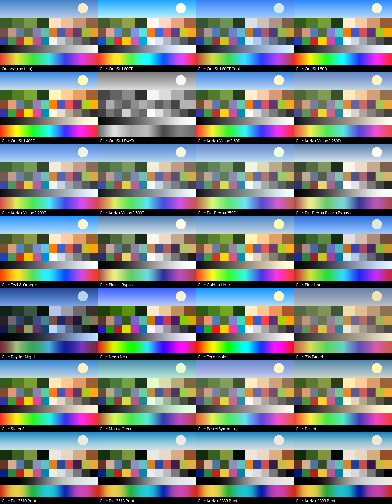

# sonyalpha-film

Film simulation for the Sony A7 II, done in camera.

Fujifilm cameras let you pick a film stock and see it live in the viewfinder, then the JPEG comes out with that look baked in. Sony never offered that. This app adds it to the A7 II through Sony's PlayMemories camera app system.

You choose a film, the screen shows it in real time, and your JPEGs and videos come out with the look. No editing afterwards.



## What it does

- 153 film looks across Polaroid, Ilford, Kodak, Fujifilm and a Cine section
- Live preview of the look in the viewfinder and on the screen
- The look is saved into your JPEGs and videos
- Strength control from 0 to 100% for every look
- Favourites, so the films you use most are at the top
- Optional halation, film grain and light leaks, added to a copy of each JPEG after you shoot
- Full manual exposure: shutter speed, ISO (including Auto), exposure compensation and the mode dial (P, A, S, M)
- White balance presets and Kelvin in 100K steps
- Focus magnifier for manual lenses
- Video recording with the look applied (MOVIE button)
- Photo playback inside the app, with the film name for each shot
- Remembers your last film, strength and white balance
- Keeps a list of which film you used for each photo in `FILMSIM/SHOTS.TXT` on the card
- Everything it changes is put back when you leave the app

## How it works

The camera's image processor has a tone curve and a colour matrix that apps are allowed to set. Sony's own Liveview Grading app used them for video. This app writes a film look into those two settings, so the camera itself does the work. That is why the preview is live and the files come out finished.

The catch is that a curve plus a matrix can't copy every film LUT perfectly. Each look has a rating so you know what you're getting:

- ◆ designed for this camera, reproduces exactly
- ★★★ very close to the original film LUT
- ★★☆ close
- ★☆☆ a rough version of the look

Effects that spread light around, like the red halation glow around lights on CineStill 800T, or grain, can't be done live. You still get the colour and contrast of those films live, and the app can add those effects afterwards (see below).

## Halation, grain and light leaks

Turn these on in the Fn menu and the app makes a developed copy of each JPEG in the background after you shoot. Your original file is never changed.

- **Halation** adds the red orange glow that bleeds around lights on CineStill film
- **Grain** comes in Fine, Medium, Heavy and Coarse (bigger clumps, like pushed high speed film). It sits in the midtones and shadows like real film grain, with a little colour for colour stocks and none for black and white
- **Light leak** adds a soft warm leak coming in from one edge of the frame, different every shot

In Film Sim's playback you see the developed copy, and C1 switches to the original. Copies are saved to `FILMSIM/DEV` on the card as `DV` plus the photo number, for example `DV05218.JPG`, at either a quarter of the photo's width (Small, the default) or half of it (Large). Small copies take seconds, Large ones a minute or two, and the screen shows "Developing" while it works. It pauses while you take a photo or record, so it never gets in the way. You need JPEG files for this, so set Quality to RAW & JPEG or JPEG.

## Film stocks

**Polaroid (22)**
664, 665, 665 Negative, 665 Negative HC, 667, 669, 669 Cold, 672, 690, 690 Cold, 690 Warm, Polachrome, PX-100UV+ Cold, PX-100UV+ Warm, PX-680, PX-680 Cold, PX-680 Warm, PX-70, PX-70 Cold, PX-70 Warm, Time Zero Expired, Time Zero Expired Cold

**Ilford (8)**
Delta 100, Delta 400, Delta 3200, FP4 Plus 125, HP5 Plus 400, HPS 800, Pan F Plus 50, XP2

**Kodak (31)**
BW400CN, ColorPlus 200, Ektachrome 100VS, Ektachrome E100GX, Ektar 100, Elite 100 X-Pro, Elite Chrome 200, Elite Chrome 400, Elite Color 200, Elite Color 400, Elite Extracolor 100, Gold 200, Gold 200 Warm, HIE Infrared, Kodachrome 25, Kodachrome 64, Kodachrome 200, Portra 160, Portra 160 NC, Portra 160 VC, Portra 400, Portra 400 NC, Portra 400 UC, Portra 400 VC, Portra 800, Portra 800 HC, T-Max 100, T-Max 400, T-Max 3200, Tri-X 400, Ultramax 400

**Fujifilm (48)**
160C, 800Z, Astia 100, Astia 100F, C200, FP-100C, FP-100C Cool, FP-100C Negative, FP-100C Slide, FP-3000B, FP-3000B HC, FP-3000B Negative, FP-3000B Negative Early, Neopan 1600, Neopan Acros 100, Pro 400H, Provia 100, Provia 100F, Provia 400F, Provia 400X, Sensia 100, Superia 100, Superia 200, Superia 200 X-Pro, Superia 400, Superia 800, Superia 1600, Superia HG 1600, Superia Reala 100, Superia X-TRA 400, Superia X-TRA 800, Velvia 50, Velvia 100, plus the X-Trans film simulations: Acros, Acros + G, Acros + R, Acros + Ye, Astia, Classic Chrome, Mono, Mono + G, Mono + R, Mono + Ye, Pro Neg Hi, Pro Neg Std, Provia, Sepia, Velvia

**Cine (44)**
Motion picture stocks: CineStill 800T, 800T Cool, 50D, 400D and BwXX, Kodak Vision3 50D, 250D, 200T and 500T, Kodak Vision2 200T 5217 and 500T 5218, Kodak Vision 500T 5279, Kodak EXR 5248, Kodak Ektachrome 100D 7294, Eastman Double-X 5222, Kodak Tri-X Reversal 7266, ORWO UN54, Fuji Eterna 250D and 500T, Fuji Eterna Vivid 160, Fuji Reala 500D, Fuji Eterna Bleach Bypass, Kodak Ektar 100, Kodachrome 64, Kodachrome 200 and Kodachrome 40 Super 8

Grades: Teal & Orange, Bleach Bypass, Golden Hour, Blue Hour, Day for Night, Neon Noir, Technicolor, Technicolor 2-Strip, 70s Faded, Super 8, Matrix Green, Pastel Symmetry, Desert

Cinema print films: Kodak 2383, Kodak 2393, Kodak 2302 B&W, Fuji 3510 and Fuji 3513

The motion picture stocks without a LUT are designed from each film's known character, so treat them as a take on the look rather than a lab-measured match.

For landscapes try Velvia 50, Provia 100F or Ektar 100. For night shots with CineStill 800T, set white balance to Tungsten or around 3200K.

## Cameras

Tested on the Sony A7 II (ILCE-7M2) with firmware 4.01.

It may also work on other Sony cameras that ran PlayMemories camera apps and supported Sony's Liveview Grading app, but I haven't tried any. If you test it on another body, please open an issue and say how it went.

## Installing

You need a computer, a USB cable and [Sony-PMCA-RE](https://github.com/ma1co/Sony-PMCA-RE) by ma1co. That tool talks to the camera over USB and installs apps the same way Sony's old app store did. Your firmware isn't touched.

1. Download `FilmSim.apk` from the [Releases](../../releases) page.
2. Get Sony-PMCA-RE. On Windows and macOS download a release from its page. On Linux clone it and install the requirements:
   ```
   git clone https://github.com/ma1co/Sony-PMCA-RE.git
   cd Sony-PMCA-RE
   pip install -r requirements.txt
   ```
3. On the camera set **MENU > Setup > USB Connection > MTP**.
4. Plug the camera in and run:
   ```
   python3 pmca-console.py install -f FilmSim.apk
   ```
   Wait until it says `Task completed successfully`.
5. Unplug, then open **MENU > Application > Film Sim** on the camera.

On Linux, if your desktop opens the camera as a photo device, unmount it first or the install can't reach the camera.

To remove the app, use **MENU > Application > Application Management** on the camera.

## Using it

| Control | What it does |
|---|---|
| Mode dial | P, A, S or M |
| Rear dial | Shutter speed in S and M, exposure compensation in P and A |
| Front dial | ISO |
| Exposure comp dial | Exposure compensation |
| Control wheel (turn) | Next or previous film |
| Fn | Open or close the menu (see below) |
| C3 | Open the menu on white balance |
| Centre button | Focus magnifier. Press again to zoom further, arrows move it, half press the shutter to leave |
| C1 | Turn the look off and on to compare |
| C2 | Strength 100, 75, 50, 25%. In the menu, adds or removes the highlighted film from Favourites |
| Up or DISP | Hide or show the info on screen |
| MOVIE | Start and stop recording |
| Play | Review photos. Left and right to browse, Play again to go back. If a photo has a developed copy it is shown instead, and C1 flips to the original |
| MENU | Leave the app |

### The Fn menu

Up and down pick a row, left and right (or the control wheel) change it. The look updates live as you scroll.

| Row | What it changes |
|---|---|
| Brand | Favourites, Polaroid, Ilford, Kodak, Fujifilm, Cine |
| Film | The film within that brand. Delete turns the film off |
| Strength | 0 to 100% in 5% steps |
| WB | Auto, Daylight, Shade, Cloudy, Tungsten, fluorescent types, Flash, Kelvin |
| Kelvin | 100K steps, switches WB to Kelvin |
| Halation | Off or On |
| Grain | Off, Fine, Medium, Heavy or Coarse |
| Light leak | Off or On |
| Copy size | Small (1500 px wide, quick) or Large (3000 px wide, takes a minute or two) |

Press Fn, centre or MENU to close it. Half pressing the shutter closes it too.

## Good to know

- **Shoot RAW + JPEG.** The look is applied when the camera processes the image. RAW files store the sensor data before that, so on a computer they open without the look. The JPEG has it.
- Using a manual lens? Keep **Release w/o Lens** turned on in the camera menu, and set the stabiliser focal length before you open the app.
- The app waits for each photo and video to finish saving before it lets you leave or open playback, so files can't get cut off.

## If something goes wrong

This is unofficial software found by reverse engineering, so use it at your own risk. In testing, the worst that happened was the app closing itself, which a restart fixed.

- If the app freezes, turn the camera off. If it won't turn off, take the battery out.
- If colours look odd after leaving the app, turn the camera off and on again.
- If a setting seems stuck, use **MENU > Setup > Setting Reset > Camera Settings Reset**. That resets your settings, not your photos.
- If the camera says "Image database file error", use **MENU > Setup > Recover Image DB**.

## Building from source

The project has three parts:

- `app/` is the camera app. It targets Android 2.3.7 (API 10), which is what the PlayMemories app system expects.
- `tools/` turns film LUTs into the camera's curve and matrix, holds the designed looks, and renders preview sheets.
- `probe/` is a small test app that checks what a camera's colour pipeline supports.

You'll need JDK 8 or newer, the Android SDK with `platforms;android-10` and build-tools 36, and a compile-only jar of Sony's camera API. Build that jar from the stubs in [OpenMemories-Framework](https://github.com/ma1co/OpenMemories-Framework) with the Jasmin assembler. Then:

```
cd app
SONY_STUBS=/path/to/sony-stubs.jar ./build.sh
```

To change the film list, edit `tools/films.csv` and rebuild `app/assets`. LUT entries are read from FilmCamera's `res/raw` folder, and `design:` entries come from `tools/.../Designer.java`:

```
cd tools
javac -d build src/com/filmsim/tools/*.java
java -cp build com.filmsim.tools.ConvertFilms films.csv /path/to/FilmCamera/app/src/main/res/raw ../app/assets
```

To see what the looks do before putting them on the camera, render a contact sheet, optionally on one of your own photos:

```
java -cp build com.filmsim.tools.Preview ../app/assets Cine sheet.png [photo.jpg]
```

## Credits

- [Sony-PMCA-RE](https://github.com/ma1co/Sony-PMCA-RE) and [OpenMemories-Framework](https://github.com/ma1co/OpenMemories-Framework) by ma1co, for making custom apps on these cameras possible
- [OpenMemoriesLUT](https://github.com/Pichuworks/OpenMemoriesLUT) by Pichuworks, which showed the curve and matrix trick on the A6000. The LUT conversion code in `tools/` comes from it (MIT, see `tools/LICENSE-OpenMemoriesLUT.txt`)
- The film LUTs come from [FilmCamera](https://github.com/jegly/FilmCamera), which uses the [Film-Luts](https://github.com/YahiaAngelo/Film-Luts) collection

## Disclaimer

This project isn't affiliated with or endorsed by Sony, Fujifilm, Kodak, Ilford, Polaroid, CineStill or anyone else named here. Their names are only used to describe the looks. All trademarks belong to their owners. No Sony firmware or Sony app files are included.

## License

GPL-3.0. See `LICENSE`.
